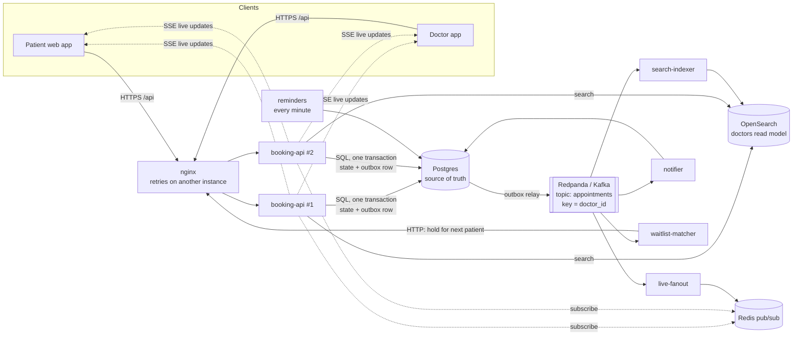

# Architecture

## The picture

## Where each guarantee is enforced

| Guarantee | Enforced by | Where |
| --- | --- | --- |
| A doctor is never double-booked | `EXCLUDE (doctor_id =, during &&) WHERE held/booked` | Postgres (0004) |
| Racers for one slot: exactly one wins | conditional `UPDATE … WHERE status = 'open'` (row lock) | `booking/holds.ts` |
| A patient is never in two places | `EXCLUDE` by patient on holds and appointments | Postgres (0011) |
| Retries never double-book | Idempotency-Key stored in the same transaction as the effect | `idempotency.ts` |
| Every change is announced exactly when it commits | transactional outbox → relay | `outbox`, `outbox-relay.ts` |
| Downstream handles duplicates | dedupe keys / rebuild from the truth | notifier, indexer, matcher |
| Abandoned holds free up | lease + heartbeat under a deadline; sweeper | `holds.ts`, `hold-sweeper.ts` |
| Doctor schedule changes are atomic | one transaction: rules, slots, bookings, events | `doctor/hours.ts`, `doctor/time-off.ts` |
| One review per completed visit, by its patient | `reviews.appointment_id` UNIQUE + `FOR UPDATE` on the appointment | `reviews.ts` (0013) |
| A rating counts every review exactly once | one `UPDATE` on the doctor row (row lock) in the review's transaction | `reviews.ts` |
| Deploys don't fail requests | graceful drain + LB retry (safe thanks to idempotency) | `shutdown.ts`, `cluster.conf` |

## Read path vs write path

- **Writes** (hold, confirm, cancel, schedule changes): booking-api → Postgres only, one transaction, plus an
  outbox row. Nothing else is on the critical path.
- **Reads**: the slot grid comes from Postgres (always true); search comes from OpenSearch (fast, may lag ~1 s);
  live updates arrive via Redis → SSE (best effort; the client refetches).

## Failure behaviour

| Down | Booking | Search | Live updates | Notifications |
| --- | --- | --- | --- | --- |
| Postgres | ✗ (it's the truth) | stale results | ✗ | ✗ |
| Redpanda | ✓ (outbox queues) | stale until back | stale until back | delayed until back |
| OpenSearch | ✓ | 503 "unavailable" | ✓ | ✓ |
| Redis | ✓ | ✓ | paused | stored, badge catches up |
| One API instance | ✓ (nginx retries the other) | ✓ | reconnects | ✓ |
